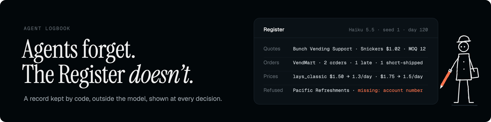
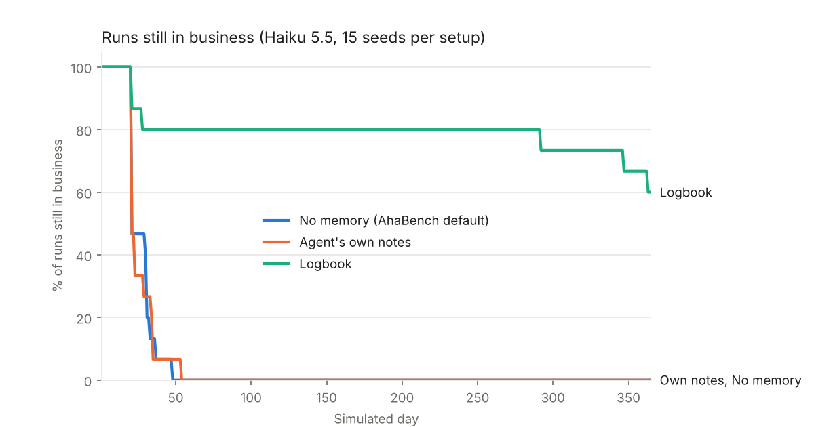
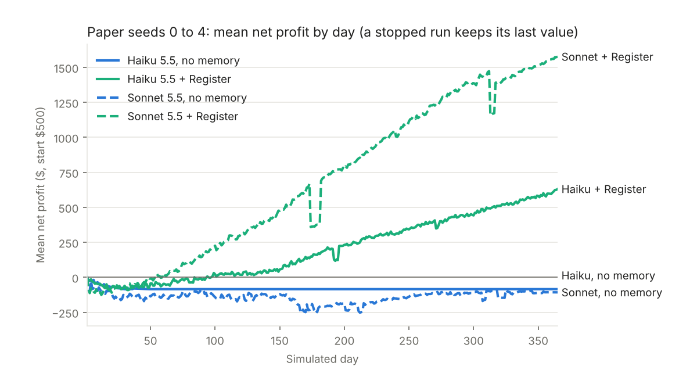
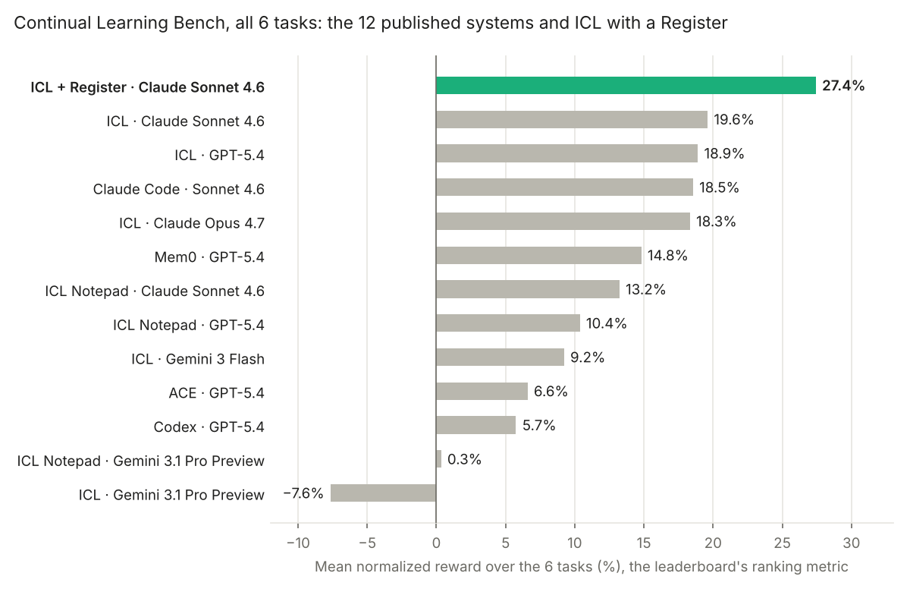

# Agent Register

Until 4 November 2026 this was called the Logbook; the code, the folder names and the run names still say `logbook` until the next release.

An agent only knows what it is sent at each call. The Register is a record kept by code, outside the model, and shown to the agent at every decision.


## Results

Four public benchmarks, each scored with its own metrics.

| Benchmark | What the agent sees | Effect of the Register |
|---|---|---|
| [AhaBench](benchmarks/ahabench): a year running a vending business | its last 8 actions | runs still in business at day 60: 0/15 → **12/15** |
| [Continual Learning Bench](benchmarks/clbench): 6 tasks, from poker to code fixes | the whole run | leaderboard score: 19.6% → **27.4%**, 1st of the 12 published systems (Claude Sonnet 4.6) |
| [τ²-bench](benchmarks/tau2-bench): customer service conversations | the whole conversation | none |
| [Vending Bench](benchmarks/vending-bench): 30 days of a vending business | its last 8 to 9 days, plus its own notes | none |







- **It helps when the agent needs a total over many steps**: a refusal that left its view 8 actions ago, a transmitter seen in earlier scans but silent in this one. When one prompt already holds what the agent needs, it gains nothing, and it is not free: on the poker task the model wrote twice as much reasoning with it, at twice the cost, and on cohort studies one run applied the rule set the Register listed as best and collapsed.
- **A small model with a Register can beat a bigger one without.** On AhaBench, Claude Haiku 5.5 with the Register beat Claude Sonnet 5.5 without it on 4 of 5 seeds, at about 1/26 of the cost.
- **What the record says matters.** A raw list of error messages did not change the agent's behavior. The same facts in the task's terms ("order refused, missing: account number") did.
- **A model can write it.** From a description of the agent and one failed run, Claude Opus 5.5 wrote Registers that kept Haiku in business at day 60 in 15/15 runs (no memory: 5/15). From the task descriptions alone, it wrote the six Registers used on Continual Learning Bench.

## How it works


During the run, at every step:

1. The world shows the agent a situation: a prompt, the result of its last action.
2. The memory, a program, reads it and counts what happened, in the task's terms: "orders to this supplier: sent 3, refused 2, reason: account number missing".
3. The agent gets its message with the memory block on top, decides, and acts.
4. The world answers. Back to 1.

The agent's own context can stay short: its last 8 actions on AhaBench, the current episode only in the `logbook_only` variant. The memory is what carries over, and it costs nothing: no model call, a few milliseconds.

Before the run:

5. You describe the agent: its goal, its tools, one example of what it receives.
6. The memory author, an LLM, writes the memory's code from that, once. It can rewrite it during the run, from what the run has shown.
7. Optionally, the agent's own instructions get a skill of four lines: how to read the memory. Counts are counts, not rules.

## Use it

Describe your agent in a spec, and a model writes its Register ([author/](author)):

```bash
python author/author.py my_agent/spec.json --past-runs --name my_logbook
```

Then call it in your agent loop:

```python
from adapter import LogbookAdapter                 # author/adapter.py
book = LogbookAdapter("written/my_logbook.py")
text = book.step(action, result, seen)             # before each decision; add text to the agent's context
```

The Registers written by hand for each benchmark are in [logbook/](logbook).

## Limits

- **It does not help everywhere.** No effect on τ²-bench or Vending Bench. On Continual Learning Bench, most of the gain comes from 2 of the 6 tasks (radio spectrum, code fixes), and poker got worse.
- **The author prompt was refined on AhaBench.** There, on fresh seeds, its Registers kept 15/15 runs in business. Unchanged, on Continual Learning Bench, they took the leaderboard score from 19.6% to 27.4%.
- **On Continual Learning Bench, the comparison is with runs published on other days.** A same-day rerun of the baseline, on 3 of the 6 tasks, confirmed the gain on radio spectrum only.
- **Few runs**: 5 to 15 per setup. Each benchmark folder gives its protocol, numbers, limits and the commands to reproduce.

## Potential improvements

Not built, or built and not measured. Each is a change to the harness, not to the model.

- **The record checks the agent's reasoning.** Where the agent's answers carry its reasoning, a `check(reasoning)` next to `observe` and `brief` would compare what the agent states about the record with the record, and show each mismatch as one line of fact at the next decision: an absolute ("never", "always", "0%") resting on fewer than five observations, a number that is no longer the current count, a claim about a counterpart the record has never seen. In a poker rollout with the whole history in context, 62 decisions of 293 state a "never" or "always" on four observations or fewer; without the history, 1 or 2, but about one absolute per decision remains without its count. Nothing of the reasoning would be stored, and the line would never say what to do. The risk is that the agent argues with the line instead of reading the counts. Cost to try: one Register rewritten offline, one rollout.
- **The Register as the only memory.** Clear the agent's context at the end of every episode, keep the Register. Being measured on Continual Learning Bench; see [benchmarks/clbench/logbook_only](benchmarks/clbench/logbook_only).
- **A skill for reading it.** Four lines in the agent's instructions: counts are counts, not rules; start from today's numbers; no advice in there; do not restate it. Being measured with the above.
- **A rewrite during the run.** The author rereads its Register and the run so far, and rewrites the code ([author/](author), step 5). Runs end to end; no gain shown on the one task tried.
- **A database behind the record.** Worth it when the record outgrows a dictionary: thousands of counterparts, several agents feeding one record, a record kept from one run to the next. Same shape either way: code writes, code queries, a short text goes into every prompt.

## Repository

```text
author/       a model writes the Register for your agent
logbook/      the Registers written by hand
benchmarks/   ahabench, clbench, tau2-bench, vending-bench: protocol, results, every run
```

Runs use Claude models through the [Anthropic](https://www.anthropic.com) API. License: MIT ([LICENSE](LICENSE)).
