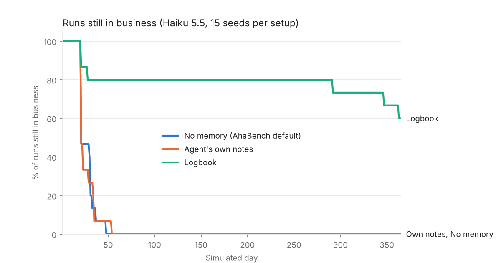
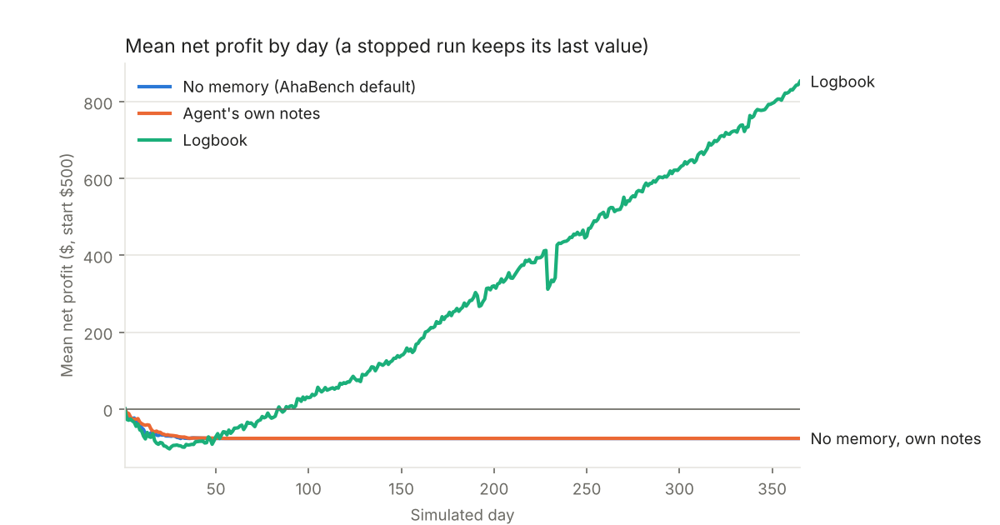
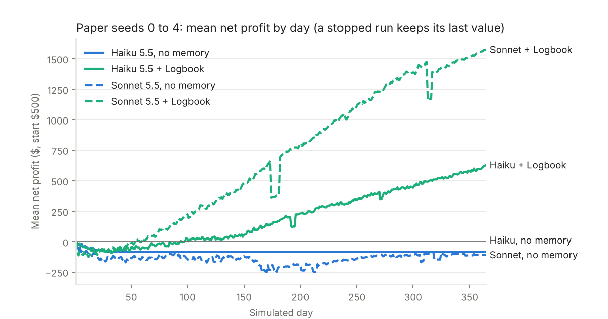

# Logbook on AhaBench (Aha-Vending)

Question: does a Logbook help an autonomous agent learn from its own experience over a long run?

Benchmark: Aha-Vending, the year-long business simulation in [AhaBench](https://github.com/Marco-Cheng/AhaBench) ([paper](https://arxiv.org/abs/2609.05435)). The agent runs a vending machine for 365 simulated days: it finds suppliers, orders by email, stocks the machine, sets prices and handles incidents (late or short deliveries, machine faults, cash theft, phishing emails). It starts with $500 and pays $2 a day. All results use the paper's own metrics.

Models: Claude Haiku 5.5 (15 seeds per setup) and Claude Sonnet 5.5 (the paper's 5 seeds), by [Anthropic](https://www.anthropic.com).

## Result





| Claude Haiku 5.5, 15 seeds per setup | No memory (AhaBench default) | Agent's own notes | Logbook |
|---|---|---|---|
| Still in business at day 60 | 0/15 | 0/15 | 12/15 |
| Completed the full year | 0/15 | 0/15 | 9/15 |
| Final net profit, median | -$77 | -$70 | +$1,099 |
| Final net profit, mean | -$77 | -$77 | +$851 |
| Profit per day, days 1-90 vs days 90-end (the paper's learning metric) | never reached day 90 | never reached day 90 | $0.33 vs $3.80 (higher later in 12 of 12 runs) |
| Tokens, all 15 runs | 10.0 M | 11.7 M | 93.0 M (its runs lasted 11 times longer) |
| Cost, all 15 runs | $0.99 | $1.23 | $9.98 |
| Cost of the first 20 days, per run | $0.048 | $0.062 | $0.040 |

Survival at day 60, Logbook vs either other setup: p = 0.00001 (Fisher's exact test). On the paper's 5 seeds alone (seeds 0 to 4): 4/5 vs 0/5 vs 0/5, p = 0.048.

## What the agent learned

- **Suppliers need the bank account number.** A supplier only accepts an order that includes it. Warned about phishing, Haiku keeps withholding it, and AhaBench stops a run after 20 days without a new order. All 30 runs with no memory or with its own notes ended this way, between day 20 and day 53. Without memory, each refusal email leaves the agent's view after 8 actions. The Logbook keeps "orders refused: missing account number xN" in view. After the first refusal, the agent included the number in 75% of its later supplier emails with the Logbook, 5% with no memory, 5% with its own notes. With notes, it wrote down the opposite lesson ("withholding bank details") in all 15 runs and kept it until the run ended.
- **Stop destroying stock.** In this benchmark a failed stock command destroys the units it took from storage (see the note below). The 12 Logbook runs that passed day 90 destroyed 54 units per run on average in the first quarter, then 7 to 14 per quarter after that.

## What kind of record works

Same benchmark, Haiku, 15 seeds per setup. Two generic Logbooks that know nothing about the task, and the task Logbook with its money and sales lines removed:

| What the Logbook keeps | Still in business at day 60 | Account number sent after a refusal | Cost, 15 runs |
|---|---|---|---|
| Nothing (no memory) | 0/15 | 5% | $0.99 |
| The agent's own notes | 0/15 | 5% | $1.23 |
| Generic v1: every error and refusal received, grouped and counted, plus the last call that worked per tool | 3/15 | 8% | $1.37 |
| Generic v2: v1 plus every sender of a repeated refusal and where each address came from | 1/15 | 2% | $1.02 |
| Task record without its money and sales lines | 11/15 | 65% | $6.82 |
| Task record (full Logbook) | 12/15 | 75% | $9.98 |

The generic versions do show the refusal, for example "x10 [read_email from 3 different senders: ...]: We can prepare this order, but we still need the following before we can proceed: account number." Haiku still does not act on it. The task record states the same thing as an outcome of the agent's own goal, for each named supplier ("Bunch Vending Support: order refused: missing info x3 (missing: account number)"), next to the suppliers found in search and their quotes, and Haiku does. Without its money and sales lines the task record keeps most of the effect on survival (11/15 vs 12/15 at day 60), so "revenue $0" was not the trigger. Those lines seem to matter for profit instead: 7/15 runs completed the year without them (9/15 with), median final profit +$290 vs +$1,099 (paired t-test p = 0.05, a hint rather than a firm result).

Order of the tests: generic v1 was run to answer "is the Logbook tailored to the benchmark?"; generic v2 and the ablation were designed after looking at why v1 failed, and run on the same seeds.

## Sonnet 5.5, with and without the Logbook

Same benchmark and settings, on the paper's seeds 0 to 4.



| Paper seeds 0 to 4 | Haiku 5.5, no memory | Haiku 5.5 + Logbook | Sonnet 5.5, no memory | Sonnet 5.5 + Logbook |
|---|---|---|---|---|
| Completed the full year | 0/5 | 4/5 | 0/5 | 4/5 |
| Final net profit, median | -$77 | +$140 | -$50 | +$1,840 |
| Final net profit, mean | -$85 | +$623 | -$108 | +$1,575 |
| Profit per day, days 1-90 vs days 90-end | never reached day 90 | -$0.15 vs $2.91 | -$1.01 vs -$0.62 | $1.66 vs $5.17 |
| Units destroyed by failed stock commands, per run | 43 (runs ended by day 47) | 91 | 580 | 51 |
| Tokens, 5 runs | 3.8 M | 30.6 M | 34.9 M | 62.0 M |
| Cost, 5 runs | $0.37 | $3.29 | $84.16 | $143.93 |

- **The Logbook also helps the stronger model.** Sonnet + Logbook beat Sonnet without memory on all 5 seeds, by $406 to $2,750 (paired t-test p = 0.014; full year 4/5 vs 0/5, p = 0.048).
- **Sonnet's lesson was the stock trap, not the account number.** Sonnet gives suppliers the account number from the start. Without memory it then destroyed about 230 units per run in each of the first two quarters; two runs ran out of cash around day 200 and three stopped reordering. With the Logbook it destroyed 46 units per run in the first quarter, then 2 per quarter for the rest of the year.
- **Haiku + Logbook beat Sonnet without memory** on 4 of the 5 seeds, at about 1/26 of the cost.
- **Format overhead.** Sonnet 5.5 answered in tool-call markup instead of the JSON the benchmark asks for in 42 to 43% of calls in both setups (Haiku: under 0.1% without memory or with the Logbook). The benchmark retries those and over 99.7% of decisions went through, but 47 to 53% of Sonnet's cost went to replies that had to be redone.

## The setups

The benchmark code, its prompts and its agent loop are unchanged. Each setup is a provider plugged in through AhaBench's own extension point (`--provider python`), sitting between the agent and the model.

- **No memory**: AhaBench's default. Each decision sees the current state and the last 8 actions, nothing older.
- **Agent's own notes**: the agent can add a `note` to any action; its last 25 notes are shown in every later decision.
- **Logbook** (`vending_logbook.py`): records what the agent was shown since day 1, and puts a short track record in the prompt's PLANNER NOTE block: units and profit per day at each price, sold-out days, effect of assortment and weather, product slot sizes, failed commands and the units they destroyed, supplier search results, quotes and refusals, orders and their issues, losses, money trend. It adds information only and blocks nothing. Every line comes from what the agent had already been shown.
- **Logbook without money and sales lines** (`--arm logbook_noout`): the same record minus the money trend, sales, price, assortment and weather lines.
- **Generic Logbook** (`generic_logbook.py`, `--arm generic`): knows nothing about the task. After every action it reads the tool's text result, keeps every line that matches a generic failure vocabulary (failed, invalid, insufficient, missing, still need, ...), grouped by message pattern and counted, and the last call that worked per tool. Messages count only when they reply to the agent's own messages; unsolicited ones (possibly phishing) are never repeated back.
- **Generic Logbook v2** (`--arm generic2`): v1 plus every sender of a repeated refusal, and where each address came from (returned by the agent's own tools, or wrote first).

## Protocol

- Scenario `v2` (the paper's incident track), `calibrated` mode, 365 days, AhaBench commit `8da1945`.
- Seeds 0 to 4 (the paper's) plus 5 to 14, because the result depended on survival.
- Model `claude-haiku-5-5`, default temperature (Claude 5.5 models reject the parameter; the paper used 0.2), up to 8,000 output tokens per call. Same settings for every setup.
- Code versions: the published `vending_logbook.py` and `logbook_provider.py` include three changes made after the first Haiku runs, none of which changes the full Logbook's record: a picklable counter (for checkpoints), the `outcomes` switch used by the ablation, and the provider now keeping only replies that are tool calls as the agent's last action.
- Metrics, as in the paper's runner (`scripts/run_ahabench.py`): final net profit (net worth minus $500), termination mode, and profit per day from day 1 to day 90 versus day 90 to the end. The runner records net worth every simulated day, the same row the paper's V1 runner writes.

## Limits

- **The task Logbook is written for this task.** Generic versions did not reproduce the effect (see above).
- **The effect is mostly survival.** No memory and notes never reach day 90, so the paper's learning metric exists only for Logbook runs. A model that includes the account number on its own would gain less.
- **Profit per day rises after day 90 for every surviving run, but part of that is the business starting up** (first orders, lost stock) and seasonal demand.
- **6 of 15 Logbook runs still stopped early**: 3 by day 27 (the agent stopped including the account number), 1 at day 291 (out of cash), 2 at days 346 and 362 (it stopped reordering).
- **Sonnet 5.5 was run on the paper's 5 seeds only**, without the agent's-notes setup.

## Note for AhaBench maintainers

In `environment_v2.py`, `_tool_run_sub_agent` removes units from storage before `machine.load` can fail (wrong slot size, unknown slot), so a failed `stock` command destroys them. The system prompt's own example uses `row`/`col` instead of `slot`, which always fails. Both affect every setup equally.

## Reproduce

```bash
git clone https://github.com/Marco-Cheng/AhaBench && cd AhaBench && git checkout 8da1945
python3.12 -m venv .venv && . .venv/bin/activate
pip install -e benchmarks/openvending httpx
export ANTHROPIC_API_KEY=...            # or ANTHROPIC_KEY_FILE=/path/to/key
python /path/to/code/aha_run_ckpt.py --arm logbook --seed 0 --out runs/eval     # arms: none, notes, logbook, logbook_noout, generic, generic2
python /path/to/code/report_aha.py runs/eval
python /path/to/code/plot_aha.py runs/eval results
```

`aha_run_ckpt.py` adds a checkpoint every simulated day to `aha_run.py` (rerun the command to resume). The first Haiku runs (no memory, notes, Logbook) used `aha_run.py`; the generic, ablation and Sonnet runs used `aha_run_ckpt.py`, for example: `python /path/to/code/aha_run_ckpt.py --arm logbook --seed 0 --model claude-sonnet-5-5 --out runs/sonnet`.

## Files

- `code/logbook_provider.py`: every setup (provider for AhaBench's `--provider python`)
- `code/vending_logbook.py`: the task Logbook for Aha-Vending; `code/generic_logbook.py`: the generic Logbook (v1 and v2)
- `code/aha_run.py`, `code/aha_run_ckpt.py`: runners (the paper's episode loop plus a daily net-worth series)
- `code/report_aha.py`, `code/analyze_aha.py`, `code/acct_analysis.py`, `code/compare_sonnet.py`, `code/plot_aha.py`, `code/plot_sonnet.py`, `code/replay_test.py`, `code/replay_generic.py`: analysis
- `results/runs.csv`: one row per run (Haiku setups including `generic`, `generic2`, `logbook_noout`; `sonnet_none`, `sonnet_logbook`); `results/summary.txt`: full report; `results/*.png`: charts
- `data/per_run.zip`: benchmark summaries, daily net worth and token usage per run (Sonnet runs under `sonnet/`)
- `data/logs_calls.zip`: every model call (prompt and reply); `data/logs_traces.zip`: environment traces
