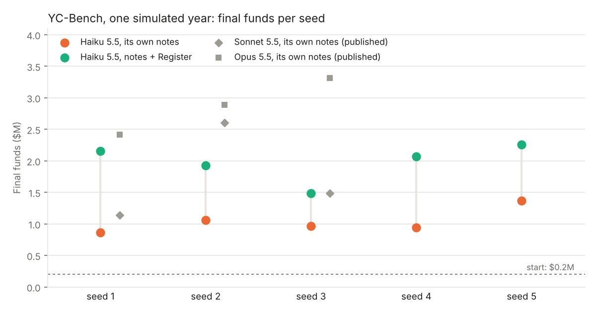
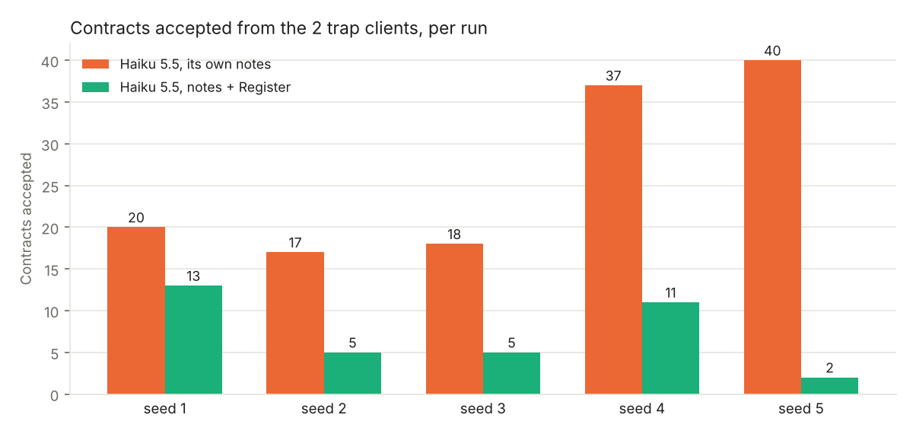

# Register on YC-Bench

Question: on a year-long startup simulation, does a Register help a small model that already keeps its own notes?



**With the Register, Claude Haiku 5.5 ends the year with more money on all 5 seeds: $1.98M on average, against $1.04M with its own notes only.** On seeds 1 to 3, that is level with the published runs of Claude Sonnet 5.5 ($1.74M), at about 1/15 of their cost.

## Benchmark

[YC-Bench](https://github.com/collinear-ai/yc-bench) by [Collinear AI](https://collinear.ai) (commit `97ca2b8`, config `default`). The agent runs a simulated AI startup for one year, from $200,000, through a command-line tool: browse the market, accept contracts, assign employees, advance time, pay the monthly payroll. The score is the funds at the end of the year. Its conversation keeps its last 20 turns; its scratchpad, notes it writes itself, is in its system prompt at every turn.

Two of the six clients are traps: once a contract is accepted, they multiply its work by 4 and keep the deadline, so the contract fails or has to be cancelled. The agent is told: "Not all clients are reliable. Check `client history` for failure patterns."

## Setups

| Claude Haiku 5.5, through the [Anthropic](https://www.anthropic.com) API | What the model receives at each turn |
|---|---|
| Own notes (the benchmark as published) | its last 20 turns, and its scratchpad in the system prompt |
| Own notes + Register | the same, plus the Register's text in the system prompt, after the scratchpad |

At each turn the Register reads the commands of the previous turn, their results and the new message, and returns at most 4,000 characters ([`code/register_harness.patch`](code/register_harness.patch)).

**Who wrote the Register.** Claude Opus 5.5, with [`author/author.py`](../../author) (prompt v2), from what the agent receives: its instructions, its tool, the code that builds its messages, and the first message of a run on seed 100, outside the evaluation, with one result of each command. No past run. Then, as `author/` allows, rewritten once after an 80-turn trial on seed 101, also outside the evaluation: replayed offline on the seed-100 run before any evaluation run, the first version kept finished contracts as active. Its count per client was already in it. No client name is written in the code. Writing both cost $1.69.

## Result

| Seed | Own notes | Own notes + Register | Contracts from the trap clients |
|---|---|---|---|
| 1 | $865k | **$2.16M** | 20 → 13 |
| 2 | $1.06M | **$1.93M** | 17 → 5 |
| 3 | $962k | **$1.48M** | 18 → 5 |
| 4 | $942k | **$2.07M** | 37 → 11 |
| 5 | $1.37M | **$2.25M** | 40 → 2 |
| **Mean** | **$1.04M** | **$1.98M** | **26.4 → 7.2** |

- Paired by seed: +$939k on average, the Register ahead on 5 of 5 seeds (one-sided sign test p = 0.031).
- Cost per run: $2.16 → $2.45.
- Seeds 1 to 3, against the published runs of the same seeds: Haiku 5.5 + Register $1.86M at $2.20 per run; Sonnet 5.5 $1.74M at $32.82; Opus 5.5 $2.87M at $42.37.



## What the traces show

- **Its notes see the symptom, not the cause.** On seed 1, Haiku wrote: "Tasks with inference/research qty ~800-900 on market often show 3-4x qty after accept". It blames the size of the contract and never names a client. Without the Register, 23.0 of its 26.4 contracts per run from the trap clients came after that client had already failed it.
- **The Register counts by client.** Mid-run on seed 5: "Equinox Labs: 0 ok, 1 failed [...] Cortex Intelligence: 46 ok, 0 failed", and it lists the market's contracts from the clients that have failed. With it, 3.0 contracts per run came after a failure.

[`results/summary.txt`](results/summary.txt) has every run, [`results/runs.csv`](results/runs.csv) one row each.

## Read with care

- **The same 6 clients, and the same 2 traps, in every seed.** YC-Bench draws its clients from a fixed seed. The Register does not know them in advance: it finds them in each run, after a few failures. The trial on seed 101 showed its author these same clients failing; it wrote no name into the code.
- **One model, 5 seeds.** Haiku 5.5 is not among the published runs: both setups ran on 5 November 2026.
- **Two changes to the benchmark's loop**, the same in both setups: the Register's text in the system prompt, and a stop when nothing has been active for 50 turns with the clock still. Without that stop a run can loop at the end of the year: `sim resume` needs an active contract, and none can finish before the horizon. The seed-1 run with its own notes only ran before the stop existed: stuck in that way, it was stopped by hand at turn 599, its funds final.

## Cost

API spend: $26.55 in all. The 10 evaluation runs: $23.06. The seed-100 run used for the replay check: $1.52. The 80-turn trial: $0.28. Writing the two Registers: $1.69.

## Reproduce

```bash
git clone https://github.com/collinear-ai/yc-bench && cd yc-bench && git checkout 97ca2b8
git apply /path/to/agent-register/benchmarks/yc-bench/code/register_harness.patch && uv sync
export ANTHROPIC_API_KEY=... YC_REGISTER_AUTHOR_DIR=/path/to/agent-register/author
mkdir -p runs/notes_s1 runs/register_s1       # each run writes db/ and results/ in its own folder
(cd runs/notes_s1 && uv run --project ../.. yc-bench run --model anthropic/claude-haiku-5-5 --seed 1 --config default --no-live)
(cd runs/register_s1 && YC_REGISTER_FILE=/path/to/agent-register/benchmarks/yc-bench/written_registers/yc_bench_2.py \
  uv run --project ../.. yc-bench run --model anthropic/claude-haiku-5-5 --seed 1 --config default --no-live)
```

`YC_REGISTER_TRACE=trace.jsonl` also records every decision, with or without a Register. Then, from [`data/runs.zip`](data/runs.zip) or your runs zipped in the same layout: `YC_BENCH_REPO=/path/to/yc-bench python code/compare.py && python code/plot.py`.

To write the Register again, from the root of this repository:

```bash
python author/author.py benchmarks/yc-bench/written_registers/specs/spec.json --name yc_bench --out written
python author/author.py benchmarks/yc-bench/written_registers/specs/spec.json --revise-from yc_bench --out written \
  --trial-report benchmarks/yc-bench/written_registers/trial_s101_report.txt --name yc_bench_2 \
  --trial-outcome 'The trial ran for 80 decisions, on another seed, to 13 March 2025 of the simulation; the funds went from $200,000 to $536,600.'
```

## Files

| Path | What it is |
|---|---|
| [`code/register_harness.patch`](code/register_harness.patch) | the two changes to YC-Bench's loop |
| [`code/compare.py`](code/compare.py), [`code/traps.py`](code/traps.py), [`code/plot.py`](code/plot.py) | the table, the contracts from the trap clients, the two charts |
| [`written_registers/yc_bench_2.py`](written_registers/yc_bench_2.py) | the Register of the runs; [`yc_bench.py`](written_registers/yc_bench.py) is the first version; each with its author's log (`.json`) |
| [`written_registers/trial_s101_report.txt`](written_registers/trial_s101_report.txt) | the 80-turn trial its author read before the rewrite |
| [`written_registers/specs/`](written_registers/specs) | what the author read: `spec.json`, the agent's instructions, its tool, YC-Bench's `prompt.py` (MIT license), the first message of a run, one result of each command |
| [`results/`](results) | `summary.txt`, `runs.csv`, `funds.png`, `traps.png` |
| [`data/runs.zip`](data/runs.zip) | every run: the benchmark's result with its full transcript, the log, and the Register's trace where one was recorded |
